<p align="center">
  
</p>

<p align="center">
  <a href="https://www.anypayx.com"></a>
  <a href="https://www.npmjs.com/package/payment-protocol"></a>
  <a href="https://www.npmjs.com/package/payment-protocol"></a>
  <a href="https://github.com/anypay/payment-protocol/blob/master/LICENSE"></a>
</p>

<p align="center">
  <a href="https://www.anypayx.com">Website</a> ·
  <a href="https://www.anypayx.com/docs">Docs</a> ·
  <a href="https://api.anypayx.com/api">API</a> ·
  <a href="https://www.anypayx.com/walletbot">WalletBot</a> ·
  <a href="https://github.com/anypay">GitHub</a> ·
  <a href="https://www.npmjs.com/package/payment-protocol">npm</a>
</p>

---

## What It Is & Purpose

**Payment Protocol** is Anypay's TypeScript/JavaScript implementation of the **JSON Payment Protocol V2** — a modern, RESTful payment flow for cryptocurrency invoices that eliminates address reuse, enforces network fees correctly, supports multi-output transactions, and provides merchant-signed payment instructions before broadcast.

The library exports a `Client` class that speaks JSON over HTTP with four distinct protocol phases: discovering available payment options, selecting a chain and currency, receiving signed payment instructions, and verifying the broadcast transaction. It is the reference implementation used by Anypay's checkout, SDKs, and WalletBot.

Built on `axios` and strongly typed with TypeScript interfaces for every message, it handles Bitcoin, Ethereum, XRP Ledger, and other chains through a single unified interface that adapts instructions per network (UTXO-based vs. account-based).

## Why Use It

**Payment Protocol** abstracts the complexity of multi-chain payment flows into four clean HTTP calls, each with a typed request and response. Wallets and payment integrations use it to retrieve exactly the outputs, amounts, fees, and invoice IDs a merchant requires — no guessing, no overpayment, no underpayment, no address confusion across testnets.

- **Who it's for:** Wallet developers, payment integrations, invoice services, and any application that sends or receives cryptocurrency payments through Anypay or compatible JSON Payment Protocol endpoints.
- **Where it fits:** This is the core protocol client. It sits between your application code and the Anypay invoice API (`api.anypayx.com` or `api.anypay.com`), and is consumed by `@anypay/client` (the full SDK), `@anypay/walletbot` (automated payment worker), and the checkout UI. If you're building a wallet, a point-of-sale, or a custom integration that needs to pay Anypay invoices programmatically, start here.

## How It Works

<p align="center">
  
</p>

The JSON Payment Protocol V2 flow has four sequential stages, each represented by a typed method on the `Client`:

1. **Payment Options** — The client calls `paymentOptions()` with the invoice URL. The server responds with available chains, currencies, estimated amounts, required fee rates, miner fees, and decimals for every supported payment method (e.g., BTC mainnet, ETH mainnet, XRP mainnet, USDC on Polygon). The response includes expiration time and a `paymentUrl` for the next step.

2. **Payment Request** — Once the user (or wallet) selects a chain and currency, the client calls `paymentRequest({ chain, currency })` and receives a `PaymentRequest` with concrete `instructions`: the exact outputs (address, amount, invoiceID for XRP), the required fee rate, and network-specific metadata. These instructions are what the wallet must follow to construct the transaction.

3. **Signed Transaction Submit** — The wallet builds and signs the transaction according to the instructions, then calls `payment({ chain, currency, transactions })` with the raw signed transaction hex (and optionally `weightedSize` for UTXO chains). The server validates the transaction structure, checks outputs and fees, and returns a `PaymentResponse` with a memo.

4. **Verified Broadcast** — Optionally, the client can call `paymentVerification({ chain, currency, transactions })` before or after broadcast to confirm the merchant has accepted the payment. The response includes the validated `Payment` object and a confirmation memo. This step is useful for double-checking before the wallet broadcasts to the network, or for polling payment status.

The entire protocol enforces type safety through TypeScript interfaces (`PaymentOptions`, `PaymentRequest`, `Payment`, `PaymentVerification`) exported from `src/protocol.ts`, and every HTTP call sets `x-paypro-version: 2` and the appropriate `Content-Type` and `Accept` headers automatically.

## Quickstart / How to Use It

### Installation

```bash
npm install payment-protocol
```

The package is distributed as compiled JavaScript in `dist/index.js` (TypeScript source is in `src/`). TypeScript definitions are included.

### Basic Usage

```typescript
import { Client } from 'payment-protocol'

// Initialize with an Anypay invoice URL
const invoiceUrl = 'https://api.anypayx.com/i/abc123'
const client = new Client(invoiceUrl)

// Step 1: Get payment options
const options = await client.paymentOptions()
console.log(options.paymentOptions) // Array of { chain, currency, estimatedAmount, ... }

// Step 2: Select a payment method and request instructions
const request = await client.paymentRequest({
  chain: 'BTC',
  currency: 'BTC'
})
console.log(request.instructions) // Outputs with addresses, amounts, fees

// Step 3: (Your wallet signs the transaction here)
const signedTx = '0100000001...' // Raw transaction hex

// Step 4: Submit the payment
const response = await client.payment({
  chain: 'BTC',
  currency: 'BTC',
  transactions: [{ tx: signedTx }]
})
console.log(response.memo) // Confirmation message

// Optional: Verify before or after broadcast
const verification = await client.paymentVerification({
  chain: 'BTC',
  currency: 'BTC',
  transactions: [{ tx: signedTx }]
})
console.log(verification.payment) // Validated payment object
```

### Protocol Interfaces

The library exports TypeScript interfaces for every message type. Import them from `payment-protocol`:

```typescript
import {
  PaymentOptions,
  PaymentOption,
  PaymentRequest,
  Payment,
  PaymentResponse,
  PaymentVerification,
  SelectPaymentRequest,
  PaymentVerificationRequest,
  Instruction,
  UtxoInstruction,
  XrpInstruction,
  Output,
  XrpOutput,
  Transaction
} from 'payment-protocol'
```

These interfaces are defined in `src/protocol.ts` and cover UTXO-based chains (Bitcoin, Litecoin, Dogecoin, Dash) and account-based chains (Ethereum, XRP Ledger, Solana) with appropriate output structures.

### Development

Build the TypeScript source into JavaScript:

```bash
npm install
npx tsc
```

The compiled output goes to `dist/`. The `main` entry in `package.json` points to `dist/index.js`.

**Note:** The repository currently has no test suite (`npm test` exits with an error). See **Next Moves for Growth** below.

## Next Moves for Growth

This library is production-ready and battle-tested in Anypay's payment stack, but several high-leverage improvements would strengthen its long-term maintainability and adoption:

1. **Add a comprehensive test suite.** The `test` script in `package.json` currently exits with an error. Add unit tests for the `Client` class (mock `axios` calls) and integration tests against a local or staging Anypay invoice endpoint. Use a framework like Jest or Mocha with `chai`. Cover all four protocol methods, edge cases (expired invoices, malformed transactions, network errors), and TypeScript type exports. This is the highest-priority item — no CI, no confidence in refactors.

2. **Publish type definitions explicitly.** While the compiled output includes `.d.ts` files, the `package.json` does not declare a `types` field. Add `"types": "dist/index.d.ts"` to ensure TypeScript consumers see the definitions. Verify with `npm pack` and inspect the tarball, then test in a separate TypeScript project that imports `payment-protocol`.

3. **Document protocol version negotiation and error handling.** The README shows the happy path; add a section on what happens when the server returns `400`, `402 Payment Required`, `410 Gone` (expired), or a non-2xx status. Show how to catch `axios` errors, inspect `error.response.status`, and retry or surface a user-friendly message. Mention that the library always sends `x-paypro-version: 2` and document the expected server behavior if the version is unsupported.

4. **Upgrade dependencies and add Dependabot.** `axios` is pinned to `^0.27.2` (June 2022); the current version is 1.x with security fixes. Run `npm outdated`, update `axios` and dev dependencies, test thoroughly, and open a PR. Enable Dependabot in the repository settings to auto-PR future updates. Check for `npm audit` warnings and patch any high/critical vulnerabilities.

5. **Add example scripts and a local dev flow.** Create an `examples/` folder with standalone scripts (`examples/basic-payment.ts`, `examples/xrp-invoice.ts`) that demonstrate real usage against the Anypay API. Add instructions in the README for running them (`npx ts-node examples/basic-payment.ts`). This lowers the barrier for new contributors and provides copy-paste starter code for integrators. Consider a `src/test_client.ts` that wraps a mock server or a localhost endpoint.

## Anypay Ecosystem & License

**Payment Protocol** is part of [Anypay](https://www.anypayx.com) — Bitcoin & Stablecoin payments for business. Merchants and developers use Anypay to accept BTC, ETH, and stablecoins such as USDC, USDT, RLUSD, and NUSD through invoices, APIs, SDKs, webhooks, WooCommerce, and mobile POS.

| Project | Role |
| --- | --- |
| [anypay](https://github.com/anypay/anypay) | Invoice & payments platform / API (`@anypay/server`) |
| [anypay-sdk](https://github.com/anypay/anypay-sdk) | TypeScript SDK for browser & Node.js (`@anypay/client`) |
| [web3-checkout-vite](https://github.com/anypay/web3-checkout-vite) | Current checkout UI (`checkout.anypayx.com`) |
| [walletbot](https://github.com/anypay/walletbot) | Self-custody headless wallet (`@anypay/walletbot`) |

**Closely related:**

- **[anypay-sdk](https://github.com/anypay/anypay-sdk)** — The full client SDK (`@anypay/client`) builds on top of this library, adding invoice creation, webhook signing, and merchant dashboard calls.
- **[walletbot](https://github.com/anypay/walletbot)** — Anypay's automated payment worker consumes this protocol client to settle invoices headlessly across Bitcoin, Ethereum, XRP, and stablecoins.

### License

Licensed under the **ISC License**. See [LICENSE](LICENSE) file in the repository for the full text.

---

<p align="center">
  <a href="https://www.anypayx.com"></a><br/>
  <sub>Bitcoin & Stablecoin Payments For Business · <a href="https://www.anypayx.com">anypayx.com</a> · <a href="https://x.com/xanypay">@xanypay</a></sub>
</p>
